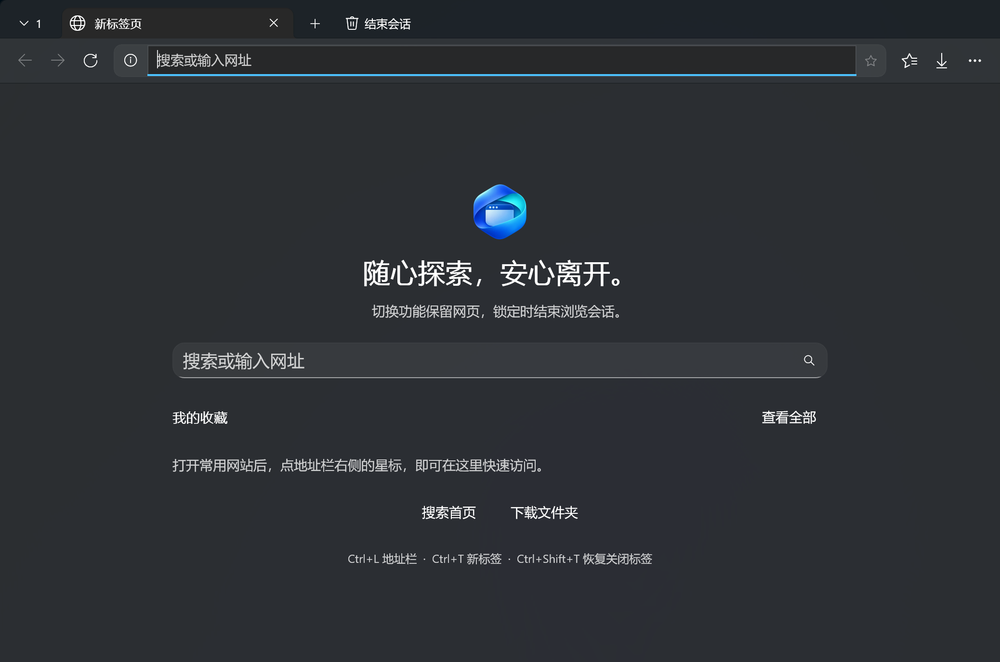

# Stealth 私密浏览器

面向 Windows 的原生浏览器与本地加密媒体工作台。基于 WinUI 3、Windows App SDK 和 Microsoft Edge WebView2。

[官网](https://canonliuliang.github.io/StealthWorkspace/) · [下载预览版](https://github.com/canonliuliang/StealthWorkspace/releases) · [安装指南](docs/INSTALL.md) · [问题反馈](https://github.com/canonliuliang/StealthWorkspace/issues)

> 当前为未签名预览项目，尚未接受独立安全审计。支持目标为 Windows 11 x64 / ARM64。临时会话不等于匿名上网，下载文件不会自动加密，当前保险箱备份依赖原 Windows 用户，不能承诺换机恢复。



## 日常使用

- **浏览**：多标签、搜索与网址识别、本地收藏/会话历史建议、标签搜索、原生查找与缩放、可恢复关闭标签。
- **下载**：跨标签共享列表，暂停、继续、取消与定位文件；关闭来源标签后仍可管理。
- **阅读图片**：网页图片阅读器与本地图片查看器，左右快速切图、长图适宽、缩放及键盘操作。
- **存放媒体**：分块 AES-GCM 加密、按需解密播放、媒体筛选与本机备份完整性检查。
- **会话与资源**：空标签按需创建内核；后台标签尝试休眠，保留表单；音频、下载和全屏页面受保护。
- **原生桌面**：深浅主题、系统动画偏好、快捷键、带图标的桌面和开始菜单入口。

## 开始使用

1. 在 Releases 选择 `win-x64`（Intel / AMD）或 `win-arm64`（Windows on Arm）。
2. 完整解压到固定目录，打开 `StealthWorkspace.exe`。请勿在 ZIP 内运行。
3. 按 [安装指南](docs/INSTALL.md) 创建快捷方式，用非重要文件先验证导入与导出。

发布包包含 .NET 与 Windows App SDK；浏览器需要 Microsoft 官方 WebView2 Runtime。未签名预览版可能触发 SmartScreen，由使用者判断是否信任，不建议关闭系统保护。

## 开发与检查

需要 Windows 和 .NET SDK 10.0.401；目标框架为 .NET 8。

```powershell
dotnet build
dotnet run
# 打包并执行核心自检
./tools/Build-Release.ps1 -Runtime win-arm64 -Version 2026.11.14-r12-preview
# 官网本地预览
node tools/site.mjs serve
```

详见 [开发说明](docs/DEVELOPMENT.md)。GitHub Actions 分别构建 x64 / ARM64，核心自检不能替代实际 UI、网站兼容性和签名分发验证。

## 使用前应了解

锁定和加密帮助保护本地内容，但不能对抗同用户恶意程序、管理员或内核级取证。临时浏览器配置可能写盘，崩溃后清理可能延迟。普通下载不因结束会话而删除；捕获排除和文件清理受 Windows 与硬件实现限制。详见 [隐私与数据说明](docs/PRIVACY.md)。

[故障排查](docs/TROUBLESHOOTING.md) · [更新记录](CHANGELOG.md) · [安全报告](SECURITY.md) · [参与开发](CONTRIBUTING.md)

项目尚未选择开源许可证；公开可见不等于授予任意使用、修改或再分发权。第三方组件遵循各自许可证。Stealth 是独立项目，与 Microsoft 无隶属关系。
