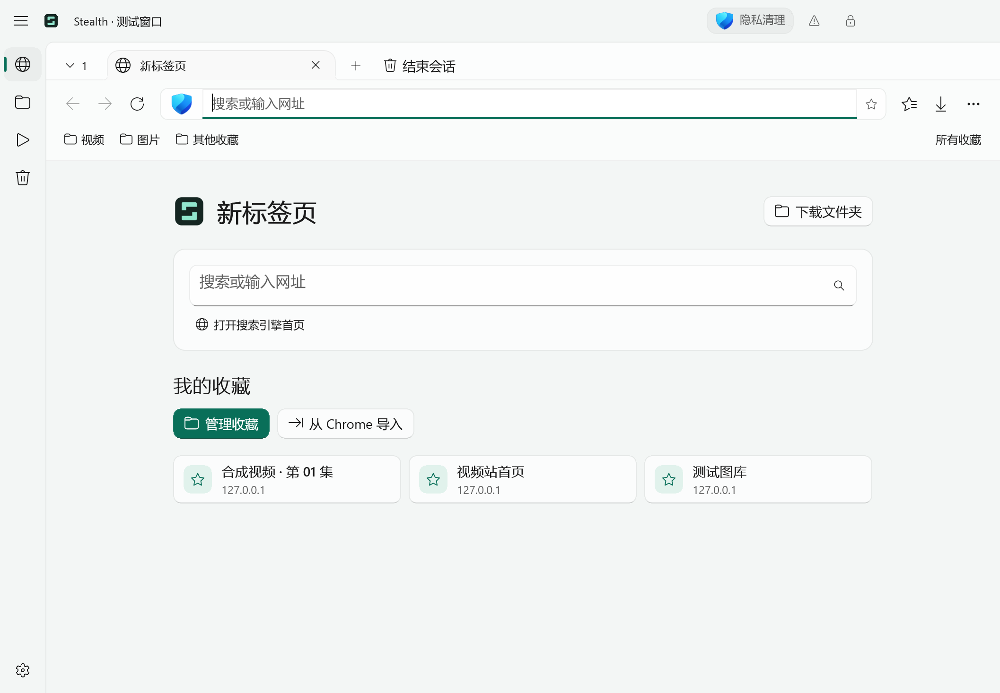

# Stealth 私密浏览器

面向 Windows 的原生浏览器与本地加密媒体工作台。基于 WinUI 3、Windows App SDK 和 Microsoft Edge WebView2。

**R16.1 第二次预览支持从 Chrome 导入分层收藏，在主空间保留网站登录，并从下载目录查看以前保存的文件。** 提供 Windows 11 x64 和 ARM64 便携包。

[官网](https://canonliuliang.github.io/StealthWorkspace/) · [R16.1 维护版下载与 SHA-256](https://github.com/canonliuliang/StealthWorkspace/releases/tag/v2026.11.21-r16.1-preview.2.1) · [安装和升级](docs/INSTALL.md) · [问题反馈](https://github.com/canonliuliang/StealthWorkspace/issues)

> 当前渠道提供未签名预览版。WebView2 会话可能写入磁盘，普通下载按明文保存。保险箱备份依赖原 Windows 用户的 DPAPI。项目尚未接受独立安全审计。



## R16.1 第二次预览

[日常浏览验收与性能测量](docs/R161-DAILY-BROWSING.md) · [网站数据和隐私边界](docs/PRIVACY.md)

本次维护更新恢复了「更多 → 在 Edge 隐私窗口打开」、标签栏的「结束会话」和盾牌中的两种仅清 Cookie 操作。普通权限下可一键交给 Edge；受限权限下可按提示打开 InPrivate 并复制当前网址。地址栏与顶部的隐私入口使用同一款蓝青色盾牌。多层目录中的便携保险箱也有修复。可以在原安装位置覆盖更新。[前一份 R16.1 下载及发行记录](https://github.com/canonliuliang/StealthWorkspace/releases/tag/v2026.11.21-r16.1-preview.2)

主空间在退出时清除本地浏览记录，保留网站允许跨重启使用的账号状态。地址栏的盾牌分别管理账号、临时文件和网站权限。Chrome 收藏 HTML 可从新标签页导入，在收藏栏直接打开嵌套文件夹中的链接。可在应用内打开下载目录、切换原目录与备用目录，或将文件复制进加密媒体库。原始下载按明文保留。

## R16.1 首次预览的变化

- **迁移收藏。** 在设置中按 Ctrl+F 搜索「收藏」，可导入其他浏览器导出的 HTML，自动去重。主空间能导出明文 HTML。诱饵空间有独立的临时收藏，锁定后清空。
- **修复一个网站。** 清理本站离线存储时保留登录 Cookie、其他来源和其他顶层站点的存储分区。Ctrl+H 可在本次会话内按标题或网址查历史。
- **保护工作区。** 可以开启「跟随 Windows 锁定工作台」。锁屏、断开会话或睡眠会撤销解锁并结束网页会话。新安装默认保留系统 DNS 缓存。
- **保护已有数据。** 设置被占用时保留原件。备份校验完成后才替换目标文件，恢复时会检查已有密文是否与待恢复文件一致。[数据完整性验收](docs/R161-DATA.md)
- **分享网页。** 在「更多操作」中选择「复制净化链接」，移除已知跟踪参数。保留业务参数、片段和当前页面，遇到识别出的签名、登录、支付或令牌链接会提示。
- **改善地址栏输入。** 粘贴含用户名和密码的裸地址时会阻止误发给搜索引擎。大量收藏的增量筛选和编辑索引也已调整。[实测结果](docs/R161-PERFORMANCE.md)

## 日常使用

- **浏览**：多标签、搜索与网址识别、本地收藏/会话历史建议、标签搜索、原生查找与缩放、可恢复关闭标签。
- **下载**：跨标签共享列表，暂停、继续、取消与定位文件；关闭来源标签后仍可管理。
- **阅读图片**：网页图片阅读器与本地图片查看器，左右快速切图、长图适宽、缩放及键盘操作。
- **存放媒体**：分块 AES-GCM 加密、按需解密播放、媒体筛选与本机备份完整性检查。
- **会话与资源**：空标签按需创建内核；后台标签尝试休眠，保留表单；音频、下载和全屏页面受保护。
- **原生桌面**：深浅主题、系统动画偏好、快捷键、带图标的桌面和开始菜单入口。

## 开始使用

1. 在 Releases 选择 `win-x64`（Intel / AMD）或 `win-arm64`（Windows on Arm）。
2. 完整解压到固定目录，打开 `StealthWorkspace.exe`。请勿在 ZIP 内运行。
3. 按 [安装指南](docs/INSTALL.md) 创建快捷方式，用非重要文件先验证导入与导出。

发布包包含 .NET 与 Windows App SDK；浏览器需要 Microsoft 官方 WebView2 Runtime。未签名预览版可能触发 SmartScreen，由使用者判断是否信任，不建议关闭系统保护。

## 开发与检查

需要 Windows 和 .NET SDK 10.0.401；目标框架为 .NET 10 LTS，自包含发布包固定使用 10.0.15 运行时。

```powershell
dotnet build
dotnet run
# 打包并执行核心自检
./tools/Build-Release.ps1 -Runtime win-arm64 -Version 2026.11.21-r16.1-preview.2.1
# 官网本地预览
node tools/site.mjs serve
```

两个架构分别在原生 Windows runner 上构建、自检。各次发行的测试环境和公开包验收日期见验证记录。[开发说明](docs/DEVELOPMENT.md) · [r16.1 研究与架构](docs/R161-REVIEW.md) · [公开包与发布渠道验收](docs/VALIDATION.md) · [首次预览发布记录](https://github.com/canonliuliang/StealthWorkspace/releases/tag/v2026.11.21-r16.1-preview) · [构建记录](https://github.com/canonliuliang/StealthWorkspace/actions/workflows/build.yml)

## 使用前应了解

锁定和加密帮助保护本地内容，但不能对抗同用户恶意程序、管理员或内核级取证。主空间的网站数据保存在本机，异常退出后浏览记录的清理可能延迟。普通下载不因结束会话而删除；捕获排除和文件清理受 Windows 与硬件实现限制。详见 [隐私与数据说明](docs/PRIVACY.md)。

[故障排查](docs/TROUBLESHOOTING.md) · [更新记录](CHANGELOG.md) · [安全报告](SECURITY.md) · [参与开发](CONTRIBUTING.md)

项目尚未选择开源许可证；公开可见不等于授予任意使用、修改或再分发权。第三方组件遵循各自许可证。Stealth 是独立项目，与 Microsoft 无隶属关系。
