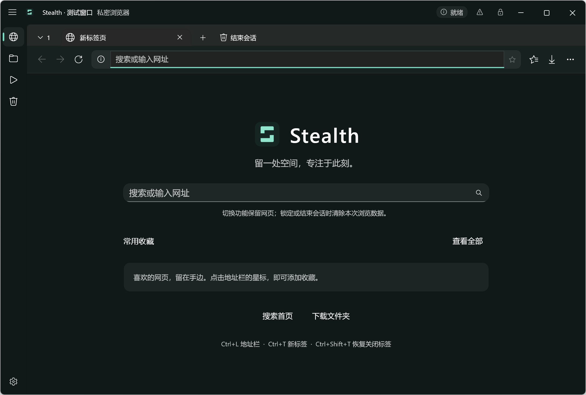

# Stealth 全面重构交付报告

> 本文保留重构阶段的 .NET 8 本地验收记录，包括当时的归档校验值和未发布状态。后续 r15 发布升级至 .NET 10 LTS；公开安装包、远程构建和网站部署的最新记录见 [验证范围](VALIDATION.md)。请使用 Release 随附的校验清单核对公开下载，不要使用本文的历史本地包校验值。

日期：2026-11-14 至 2026-11-15。验证环境：Windows 11 ARM64（10.0.26300）、.NET SDK 10.0.401、.NET 8.0.31、WebView2 Runtime 157.0.4341.46；界面核验使用 WinApp CLI 0.8.0，显示缩放为 200%。

> **状态：双架构本地发布包已完成本轮验收。** ARM64 与 x64 发布包各有 206 项核心测试通过、0 失败、2 项环境跳过，两套完整界面巡检均通过；ARM64 的浏览器审计、图片体验、渲染、诊断隔离与三分钟持续测试全部通过。交付目录为 `artifacts/releases/2026.11.14-r15-accepted/{win-arm64,win-x64}`，显示版本为 `2026.11.14-r15-preview`。源码提交、运行入口、归档和 SHA-256 已列在本文第 5 节。没有远程发布或生产部署。

## 1. 备份与可验证回滚

所有重构开始前，已经保存原始工作区，包括用户原有、尚未提交的安全修复。原始 `main` 保持不变。

| 回滚信息 | 记录 |
| --- | --- |
| 原始 HEAD | `7260c3dd20e6f64db57ac2443360ce327bd28807` |
| 原始分支 | `main` |
| 含原有未提交工作的快照提交 | `0e0d61dc544c54e3e4e5924fea0e8c247de788ba` |
| 备份分支 | `codex/backup-pre-overhaul-20261114` |
| 备份标签 | `backup/pre-overhaul-20261114` |
| 重构分支 | `codex/stealth-overhaul-20261114` |
| 完整目录快照 | `../StealthWorkspace-Backups/pre-overhaul-20261114/project` |
| 离线 Git 备份 | `../StealthWorkspace-Backups/pre-overhaul-20261114/rollback.bundle`，已验证完整历史 |
| 完整文件校验 | **18,642 个文件，6,986,787,981 字节**；与原目录逐文件 SHA-256 比对通过 |
| 恢复演练 | `../StealthWorkspace-Backups/verified-restore-rehearsal-20261114`；恢复后再次核验全部 18,642 个文件 |

在项目目录运行一键恢复：

```powershell
./tools/Restore-PreOverhaul.ps1
```

恢复脚本新建相邻的 `StealthWorkspace-Restored-时间戳` 目录，再逐文件验证备份清单中的 SHA-256。目标目录已经存在时拒绝覆盖；不会修改当前重构目录或正在使用的保险箱。快照包含当时的源代码、资源、配置、依赖信息及本地项目产物；Git 分支/标签和完整目录备份各自保留，避免仅依赖单一恢复手段。恢复演练证据见 `artifacts/overhaul-baseline/restore-rehearsal.txt`。

## 2. 界面与交互升级

### 品牌与设计体系

- 重绘可编辑的矢量 Logo：以错位折角和负空间构成标记，采用平面青玉色与石墨底色。提供 SVG、PNG 和包含 9 个尺寸的 Windows ICO；不再沿用原有多层蓝色渐变图标。
- 在标题栏、锁屏和新标签页统一 Logo 与 Stealth 字标。集中管理深色、浅色、强调色、圆角和文字样式；原生控件的导航选中线、焦点和开关也统一使用青玉调色板。
- 保留原生控件模板、键盘焦点与系统动画偏好，没有增加持续装饰动画。高对比主题使用系统颜色资源；其资源配置已保留，完整高对比人工验收仍需单独列明，不能用深浅主题截图替代。
- 辅助文字不再使用 8–11px 的密集字号；常规辅助字号至少 12px，设置说明为 13px，页面标题为 28px。
- 颜色计算结果：浅色强调按钮对比度 4.94:1、浅色徽标文字 5.28:1、深色强调按钮 9.54:1、深色徽标文字 7.00:1。它们是指定颜色组合的计算值，并非对所有状态的自动可访问性认证。

### 页面与状态

- **浏览器：** 收紧工具栏层次，重排新标签页的品牌、搜索、收藏和快捷提示；收藏为空时给出明确的下一步。收藏和更多菜单首次打开才创建内容，后续复用。
- **锁屏：** 使用统一品牌与清晰的密码操作层级，保留首次设置、备份恢复、错误及验证中的状态。
- **媒体库：** 采用 168×188 的卡片和 100px 预览区；搜索无结果与没有文件使用不同文案。导入、筛选、取消、失败重试与拖放功能保留。
- **播放器：** 增加可操作的空状态，可以直接打开媒体库；没有媒体时不再留下空的播放控制或格式胶囊。保留图片、视频、缩放、适宽和返回状态。
- **设置：** 说明文字允许换行，开关使用弹性两列，选择框保留下方布局，避免固定 220/260px 控件列挤压说明；备份操作并排显示。
- **痕迹清理：** 将拥挤的六列条目改为分层展示的列表，保留虚拟化；危险性较高的高级选项放入可展开区域，不改变默认勾选策略。
- **可访问性与文案：** 状态入口改为可通过键盘操作的按钮；为导入、返回、图标按钮、设置、隐私页签和清理选项补齐可访问名称。移除“杜绝暴露”“绝对防窥”等超过实际能力的描述；下载文件明确不自动加密。

已独立检查 640 DIP 宽、200% 缩放下的浅色浏览器、设置、媒体库和清理页面，没有发现阻断性截断、重叠或关键操作不可见。清理列表底部条目截断属于正常滚动视口。证据位于 `artifacts/overhaul-final/*-light-640.png`。

最后一轮深色浏览器、播放器与锁屏截图也已独立验收，没有阻断性视觉问题；青玉强调色、关键操作和文字层级完整。证据为 `browser-dark-reviewed.png`、`player-dark-reviewed.png`、`lock-dark-reviewed.png`，均位于 `artifacts/overhaul-final`。WinApp UIA 实际点击状态入口到清理页、播放器空状态按钮到媒体库、锁定与正常关闭的记录保存在 `visual-dark-result.txt`。这些截图来自与最终发布界面同源的 Debug；之后没有界面变动。最终发布包另有实际界面巡检通过记录，图示本身不作为 Release 构建证明。

最终还使用实际交付的 ARM64 Release 启动独立合成窗口，通过 WinApp CLI 检查控件树、捕获下图并正常关闭。证据为 `artifacts/overhaul-final/preview-release-result.txt`，退出时三项清理检查均通过。



## 3. 性能与架构改动

- 将收藏和更多菜单延迟构造，减少每个空标签页建立时创建的控件数量；去掉重复的标签栏淡入和不必要的重新绑定。
- 按实际 DPI 需要解码站点图标，避免为 16/32px 显示目标持续保留过大解码结果。
- 地址建议先做低成本文本筛选，不再为不匹配的收藏反复解析 URI；收藏身份检查只解析一次当前地址。
- 媒体库的大列表搜索加入延迟合并和批量集合更新，小变动继续使用增量通知；缓存未变化的统计值，并在打开查看器前完成待处理筛选，保持返回后的查询、筛选和选中状态。
- 将密码派生和验证移出保险箱共享状态锁，缩短读取状态与锁定被阻塞的时间。PBKDF2 仍为 **600,000 次迭代**，没有通过降低密码强度换取响应速度。
- 解锁结果改为可释放、单次消费的结果对象，结合版本/会话检查拒绝过期或跨保险箱凭据；显式锁定能够撤销仍在途的验证结果。
- 初始化失败可重新尝试；初始化期间发生锁定时，不再在创建完成后自动解锁。
- 增加可复用的核心、UI、浏览器 A/B、共享锁竞争和回滚验证工具。测试输出拒绝覆盖旧结果，保留失败证据。

### 同机实测与解释

以下均为这台 ARM64 主机上的合成或受控场景。除明确注明外，不代表互联网网站加载速度或整机体验按相同比例变化。

| 指标与条件 | 重构前 | 已记录的较新结果 | 可以得出的结论 |
| --- | --- | --- | --- |
| 空浏览器控件构造，Debug ARM64、12 个控件的同一测试流程 | 平均 6.18ms/个 | 平均 **4.32ms/个** | 最后验收样本约减少 **30.1%** 构造耗时 |
| 同一空控件构造的托管分配 | 105.1KiB/个 | **81.1KiB/个** | 最后验收样本约减少 **22.8%** 分配；不等于总进程内存下降 |
| 10,000 条收藏、无匹配查询，31 次样本中位数 | 1.2495ms | **0.1727ms** | 本地建议计算的 CPU 开销下降 |
| 50,000 条收藏、无匹配查询，31 次样本中位数 | 3.0615ms | **0.5950ms** | 同一合成查询约减少 81% 计算耗时 |
| 同一 50,000 条无匹配查询的分配 | 2,801,744 字节 | **1,632 字节** | 避免无效 URI/结果对象分配 |
| 媒体库从 10,000 项筛到 2,000 项的集合通知 | 8,000 次移除通知 | **1 次 Reset** | 降低大筛选的通知量；不是 FPS 数据 |
| 密码验证并发时读取 `IsUnlocked` 的等待，均为 Debug ARM64 | 中位 **28.4709ms** | 中位 **0.0025ms**，最大 **0.0083ms** | 验证移出共享锁后，本次 7 个样本的状态读取不再等待整轮密码派生 |
| 密码验证并发时执行 `Lock` 的等待，均为 Debug ARM64 | 中位 **31.2069ms** | 中位 **0.0072ms**，最大 **1.2085ms** | 本次样本的锁定阻塞明显减少；保留最大值，不以中位数代表最坏情况 |
| 合成网页滚动的 rAF 间隔中位数 | 约 16.7ms | 约 **16.7ms** | 没有证据支持网页 FPS 提升的宣称 |
| 最终 ARM64 Release 合成网页滚动的应用侧 rAF P95 | — | 两轮分别约 **17.5ms / 18.2ms** | 记录稳定性样本，不能替代长期或真实站点测试 |

空控件构造的较早候选结果包括 **2.94ms**、**3.31ms / 80.6KiB** 和 **3.77ms / 77.7KiB**。本文使用最后 Debug 验收的 **4.32ms / 81.1KiB**，不挑选最快的一次作为最终提升；构建阶段和运行噪声均会影响结果。较早 Release 锁竞争中位数约为 `IsUnlocked` 0.002ms、`Lock` 0.004ms，仅作为独立配置的历史记录保留，未与 Debug 基线混用推导提升。

最后 Debug 验收中，40 次打开、加载、关闭循环后，诊断 GC 未保留已关闭的控件引用，计数为 **0**；应用私有内存为 **83.1→93.8MiB**。较早 Debug 记录为 **83.7→97.0MiB**，同样保留。两组都不能支持总内存降低或长期没有泄漏的宣称。三分钟持续测试完成 12 轮，保留的 DOM 状态与结束会话清理通过；三分钟样本不等于数天稳定性证明。

主要性能证据：

- `artifacts/overhaul-baseline/ui-smoke.txt`、`vault-contention.json`、`render.txt`。
- `artifacts/overhaul-final/smoke-debug-accepted/result.txt`：4.32ms、81.1KiB、40 轮后 0 个关闭控件引用、私有内存 83.1→93.8MiB，结尾 `SMOKE RESULT: OK`。
- `artifacts/overhaul-final/smoke-debug-lock-recheck/result.txt`：保留较早 3.77ms、77.7KiB 和 83.7→97.0MiB 的运行记录。
- `artifacts/overhaul-browser-performance-final/results.json` 与 `source-hashes.json`：固定 200/10,000/50,000 条收藏、31 次样本、16 个完整建议结果等价场景和 100 对 URI 身份验证。
- `artifacts/overhaul-final/vault-contention-debug-accepted.json`：与基线同为 Debug ARM64，7 次样本、程序集 SHA-256 和 600,000 次密码派生参数；记录中位数与最大值。
- `artifacts/overhaul-final/vault-contention-verified.json`：保留候选 Release 的独立历史测量，不与 Debug 混用。
- `artifacts/overhaul-final/accepted-render-arm64/result.txt`：最终 ARM64 发布包中位 16.7ms，应用侧两轮 P95 分别为 17.5ms / 18.2ms；该两轮均没有超过 33ms 的 rAF 间隔。较早候选两轮 P95 18.2ms 的结果保留在 `verified-render-arm64/result.txt`。

## 4. 数据安全与回归防护

本轮保留原存储格式与已有加密机制，没有进行不可逆的数据格式升级。

- 导出不能覆盖保险箱内部文件或无关的 `.part` 文件；取消导出保留原目标。
- 可选的原件覆写清理绑定导入时文件身份和内容，防止在源文件被替换后处理错误对象。
- 锁定后的过期会话不能提交导入；索引中的长度检查拒绝被伪造为空的非空加密内容。
- 旧配置迁移失败或源配置损坏时保留源文件；临时明文缓冲区在使用后清零。
- 备份恢复仍拒绝覆盖现有保险箱，继续验证完整性、路径穿越、主/诱饵空间和恢复后的解密结果。
- 初始化中锁定、重复锁定、锁定状态下最小化、旧解锁结果重放等边界增加了回归覆盖。
- 旧保险箱迁移与重置后防复活的 7 项回归已通过：覆盖源数据保留、无关目标数据隔离、异常旧索引、重置后重新加载/迁移不复活旧源，以及重置标记写入失败时保留内容和恢复意图。这些结果包含在最后 Debug 的 206 项通过中。
- 最终 ARM64 发布包的诊断隔离验收通过：不显式指定数据根的诊断启动会建立独立目录，没有导入合成旧数据；核心自检与正常退出清理通过，前后旧数据哨兵哈希保持不变。证据为 `accepted-diagnostic-isolation/isolation-result.json`。这项测试仅验证诊断数据隔离，不等同于真实用户迁移或剪贴板验证。

第一次集成核心测试曾暴露一个旧测试顺序：它试图应用在 `Lock` 之前取得的凭据。测试已改为在锁定后重新验证密码，独立的过期凭据拒绝测试继续保留；没有通过允许旧凭据重新解锁来迁就测试。

## 5. 最终包验收、运行入口与校验

| 验证项 | 证据 | 状态 |
| --- | --- | --- |
| 原始构建与基线 | 0 警告、0 错误；原始核心 168 通过、0 失败、1 跳过 | 已冻结 |
| 最后 Debug 核心与界面 | `core-debug-accepted.txt` 为 206/0/2；`smoke-debug-accepted/result.txt` 为 `SMOKE RESULT: OK` | 通过，保留为同配置性能证据 |
| 最终 ARM64 核心 | 发布目录 `win-arm64/core-tests.txt`：**206 通过、0 失败、2 跳过** | 通过 |
| 最终 x64 核心 | 发布目录 `win-x64/core-tests.txt`：**206 通过、0 失败、2 跳过** | 通过 |
| 最终双架构界面巡检 | `accepted-smoke-arm64`、`accepted-smoke-x64` 均为 `SMOKE RESULT: OK`，含真实页面访问、锁定/再解锁、延迟菜单及退出清理 | 通过；x64 在 ARM64 环境运行，不是独立 x64 硬件验证 |
| 最终浏览器审计 | `accepted-browser-arm64/result.txt` 为 `AUDIT RESULT: OK`；覆盖 Cookie 范围、弹窗/POST、全屏、原生缩放、图片阅读器，以及来源标签关闭后的共享下载管理 | 通过 |
| 最终图片体验 | `accepted-experience-arm64/result.txt` 为 `EXPERIENCE RESULT: OK`；包括解码失败后恢复、返回媒体库状态和加载中锁定 | 通过 |
| 最终渲染审计 | `accepted-render-arm64/result.txt` 为 `RENDER AUDIT: OK` | 通过 |
| 最终诊断隔离 | `accepted-diagnostic-isolation/isolation-result.json` 为 `Passed`，独立数据根、无合成旧数据导入、哨兵未变、正常清理及 206/0/2 自检 | 通过 |
| 最终三分钟持续测试 | `accepted-soak-arm64/result.txt` 为 `SOAK RESULT: OK`；3.01 分钟、12 轮、宿主私有内存峰值 72.6 MiB，页面状态保留、会话与退出清理通过 | 通过；此轮实际休眠接受数为 0，不宣称所有后台标签能休眠 |
| 640 DIP / 200% 浅色布局 | 浏览器、设置、媒体库、清理截图经独立复审，无阻断性问题 | 通过 |
| 最后一轮深色布局 | 浏览器、播放器、锁屏三张 `*-dark-reviewed.png` 经独立复审，无阻断性问题 | 同源 Debug 实机图通过；后续没有视觉改动 |
| UI 自动化 | WinApp CLI / UIA 检查导航、主题切换、状态入口、播放器空状态、锁定和关闭；补齐缺失的可访问名称 | 已完成上述场景；完整读屏/高对比人工验证不在此结论内 |

除发布目录中的核心报告外，上表日志位于 `artifacts/overhaul-final/`。较早失败结果继续保留：首次 `delivery-smoke-x64` 在焦点断言尚未等候实际菜单状态时过早读到 `False`。修正的是测试观测时序——实际跟踪 `Opening`、`Opened`、`Closed`，并在低优先级调度屏障后执行更严格的断言；没有放宽生产行为或跳过场景。修正后 ARM64 / x64 的完整最终巡检均通过。新空标签页共享下载焦点竞态也已经修复，Debug 与最终 ARM64 浏览器审计均验证通过。

### 运行与归档

- 应用显示版本：`2026.11.14-r15-preview`。
- 最终源码提交：`264f437cd1d32c852d37018fac38283ac2f07360`。
- 交付目录批次：`artifacts/releases/2026.11.14-r15-accepted`；此前 `r15-delivery`、`r15-verified` 仅为保留证据的中间候选。
- ARM64 本地运行入口：`artifacts/releases/2026.11.14-r15-accepted/win-arm64/app/StealthWorkspace.exe`。
- x64 本地运行入口：`artifacts/releases/2026.11.14-r15-accepted/win-x64/app/StealthWorkspace.exe`。
- 使用 ZIP 时应完整解压到新目录后运行，不在压缩包内直接启动，也不要单独移动 EXE。用户数据和现有快捷方式没有被这两个本地包替换。

| 架构 | 归档（相对于对应架构目录） | SHA-256 |
| --- | --- | --- |
| ARM64 | `Stealth-2026.11.14-r15-preview-win-arm64.zip` | `840b25bf8065481ce7bc3deff03a903917fc08a96fcbc4549a1b4f502437ad0f` |
| x64 | `Stealth-2026.11.14-r15-preview-win-x64.zip` | `109f9cb55d03c038f0d6e3bc8db6dcd5d15da4f36b0d749f36ad8780627d9a50` |

对应目录还提供 `SHA256SUMS.txt` 与 `core-tests.txt`。归档重新计算的 SHA-256 与清单一致，ZIP 内程序集与实际受测程序逐字节哈希一致；ARM64 归档为 93,402,776 字节、542 项，x64 为 95,363,634 字节、546 项，未发现保险箱、密钥或会话数据。证据为 `artifacts/overhaul-final/package-integrity.json`。

验收归档检查点标签为 `checkpoint/overhaul-validated-20261115`，最终源码与历史另存为 `../StealthWorkspace-Backups/overhaul-accepted-20261115.bundle` 并验证。本轮没有仍待执行的发布包验收步骤；下面的适用边界和未覆盖场景保持公开记录。

## 6. 复现方式与适用边界

复现入口位于 `tools/Test-Core.ps1`、`tools/Test-UI.ps1`、`tools/Test-BrowserPerformance.ps1` 和 `tools/Measure-VaultContention.ps1`。核心测试传入 `-PublishDirectory`；UI 测试传入 `-AppDirectory` 并选择 `Smoke`、`Render`、`Browser`、`Experience` 或 `Soak`；地址建议对比传入完整备份源目录作为 `-BaselineRoot`；锁竞争测试传入应用目录与新的输出文件。使用新的输出位置，避免把旧报告误当作新验证。

- **两项 SUBST 测试跳过：** Removal 测试创建临时盘符映射被环境拒绝；Vault boundary 测试没有找到覆盖测试目录的现存映射，且没有尝试新建。没有修改机器映射，其他路径身份测试不能替代这两项。
- **休眠是尽力行为：** 部分页面/场景下 WebView2 会拒绝休眠；已记录的成功休眠样本不能被表述为每个后台标签都保证休眠。
- **性能结论限于本机：** 当前是 ARM64、Parallels WDDM 图形环境和合成页面；不能据此承诺其他硬件、真实网络、任意站点、编解码器或长期负载的统一提升。
- **加密历史边界保留：** SVAULT02 的历史零字节文件没有数据认证块。本轮没有更改格式，不能对该旧格式作超出实际机制的完整性承诺。
- **备份仍绑定原 Windows 用户：** DPAPI 相关数据不保证在换机、重装系统或其他用户下恢复；本轮没有把它改成可移植备份格式。
- **旧副本仍然保留：** 成功迁移旧保险箱也保留原 Store。重置只处理当前保险箱，旧目录、导出文件和外部备份不会被一并删除；持久标记阻止旧目录在重置后自动重新导入。
- **未签名预览：** 没有完成第三方安全审计或签名分发；浏览会话隔离不等于匿名上网，普通下载不自动加密。
- **现有快捷方式未更新：** 本轮不把文件存在当作图标可见或实际启动正确的证明；用户现有入口保持原样，最终包不会被误报为已替换所有桌面/开始菜单入口。
- **没有生产部署：** 所有发布包与测试在本地，未把未经完整验证的候选推送到线上。

## 官方研究参考

- [WebView2 性能建议](https://learn.microsoft.com/en-us/microsoft-edge/webview2/concepts/performance)：按需创建、后台资源和生命周期审查。
- [优化 GridView 与 ListView](https://learn.microsoft.com/en-us/windows/apps/develop/performance/optimize-gridview-and-listview)：保留虚拟化并减少集合更新开销。
- [保持 UI 线程响应](https://learn.microsoft.com/en-us/windows/apps/develop/performance/keep-ui-thread-responsive)：将耗时工作与 UI 更新分离。
- [Windows 应用主题](https://learn.microsoft.com/en-us/windows/apps/develop/ui/theming)：原生强调色、主题资源与高对比颜色。
