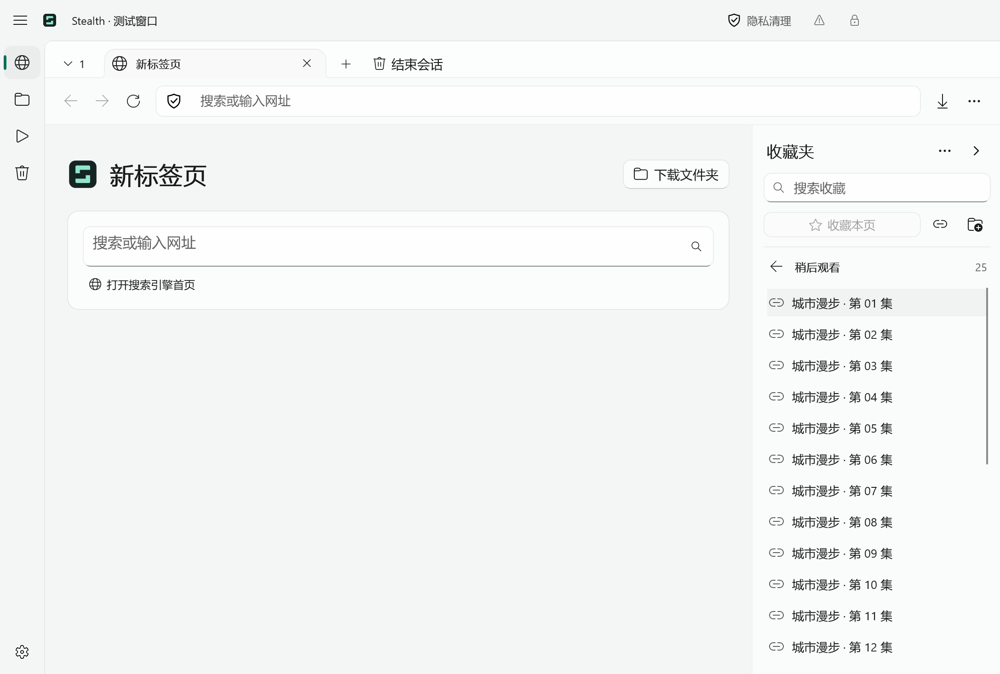

# Stealth R16.1 右侧收藏夹

版本 `2026.11.21-r16.1-preview.2.2`，适用于 Windows 11 x64 和 ARM64。

点网页右缘的收藏夹图标，可以一边阅读，一边在右侧查看链接和文件夹。宽窗口中收藏夹与网页并排显示。在窄窗口中打开时会覆盖网页右侧，收起后仍能回到原来的阅读位置。进入网页全屏时，收藏夹随浏览器工具栏隐藏。

- 单击文件夹可逐层浏览，单击链接在当前标签打开。Ctrl+单击或鼠标中键会在后台新标签打开链接。
- 搜索框可跨文件夹查找收藏，并显示结果所在的位置。面板支持收藏本页、添加链接和新建文件夹。右击条目可编辑或移动。删除文件夹前，面板会提示其中的收藏也会删除。
- 主空间收藏夹的「…」菜单提供 Chrome 书签 HTML 导入和导出。导入保留嵌套文件夹，导出的 HTML 包含明文标题与完整网址。
- 地址栏和顶部隐私入口改用线框盾牌。主空间仍可保留网站登录，网页临时文件、Cookie 和离线数据可以分别管理。

## 下载与升级

根据电脑选择 `Stealth-2026.11.21-r16.1-preview.2.2-win-x64.zip`（Intel / AMD）或 `Stealth-2026.11.21-r16.1-preview.2.2-win-arm64.zip`（Windows on Arm）。请与同一 Release 的 `SHA256SUMS.txt` 核对。更新前备份重要文件并正常退出 Stealth。完整解压新 ZIP，在原安装位置更新程序文件并保留原有 `WorkspaceData`。运行网页需要 Microsoft Edge WebView2 Runtime。本预览版未使用受信任发布者证书签名，Windows 可能显示 SmartScreen。

[安装和升级指南](https://github.com/canonliuliang/StealthWorkspace/blob/v2026.11.21-r16.1-preview.2.2/docs/INSTALL.md) · [隐私说明](https://github.com/canonliuliang/StealthWorkspace/blob/v2026.11.21-r16.1-preview.2.2/docs/PRIVACY.md) · [已知限制与故障排查](https://github.com/canonliuliang/StealthWorkspace/blob/v2026.11.21-r16.1-preview.2.2/docs/TROUBLESHOOTING.md) · [上一维护版](https://github.com/canonliuliang/StealthWorkspace/releases/tag/v2026.11.21-r16.1-preview.2.1)
